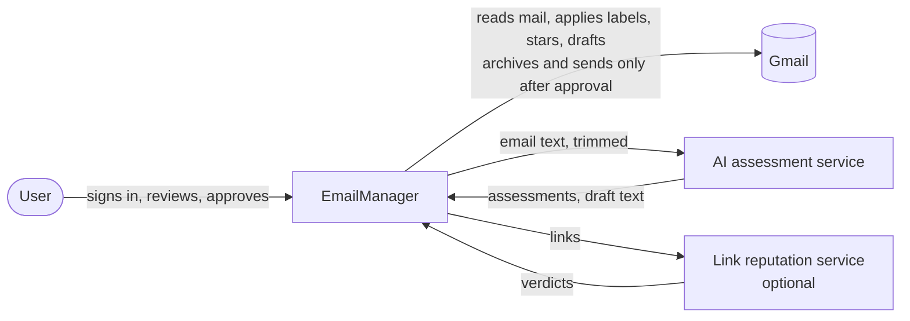
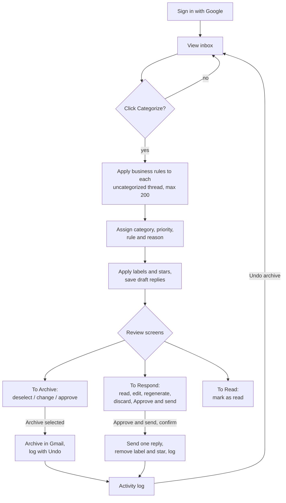
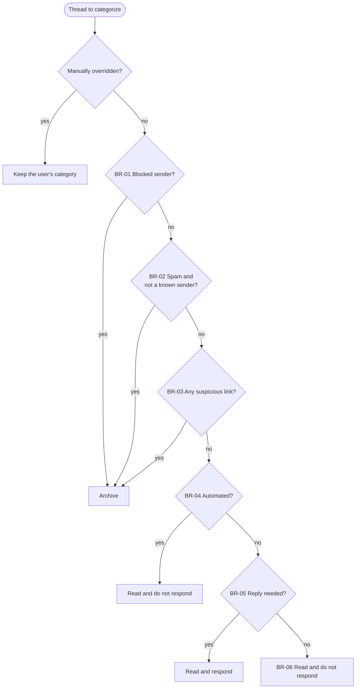
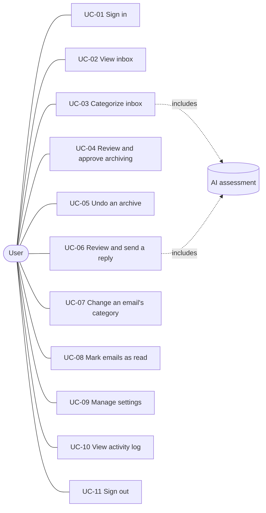
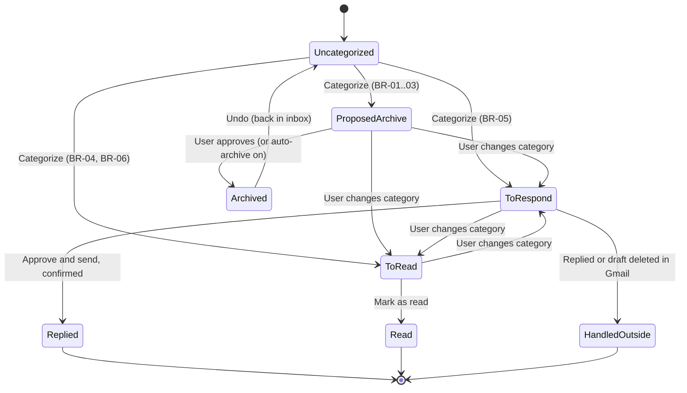

# EmailManager: Business Requirements Specification

**Version:** 1.0 · **Date:** 2026-11-18 · **Derived from:** EmailManager requirements v1.4 and step 2 answers

This specification contains only the business requirements, rules and decisions for EmailManager. It leaves out all
technical choices (programming languages, databases, hosting mechanics), so a Creator can give it to a new project and
get another version of the application. Technology is decided by the
[new-project playbook](./CREATOR_PLAYBOOK.md).

**Contents**

1. Vision and goals
2. Scope
3. Stakeholders and actors
4. Glossary
5. Context and workflow diagrams
6. Use cases
7. User stories with acceptance criteria
8. Business rules
9. Decision tables
10. Email lifecycle (state diagram)
11. Screens
12. Configurable settings and defaults
13. Business decisions
14. Non-functional requirements
15. Delivery milestones

---

## 1. Vision and goals

**Problem.** Busy professionals lose time sorting their inbox, and important emails that need a reply get buried among
newsletters, notifications, junk and phishing.

**Vision.** EmailManager sorts the user's inbox into three action categories, flags what's urgent, and prepares draft
replies. Nothing is changed in the mailbox, and nothing is sent, until the user has reviewed it.

**Goals**

| ID  | Goal                               | Measure                                                                                          |
| --- | ---------------------------------- | ------------------------------------------------------------------------------------------------ |
| G1  | Spend less time triaging email     | 100 emails categorized in under 2 minutes                                                        |
| G2  | Respond quickly to important email | High-priority emails needing a reply appear first on To Respond, with a draft ready              |
| G3  | Never lose or wrongly send email   | Nothing is deleted; nothing is sent without explicit per-reply approval; archiving can be undone |
| G4  | Protect against junk and phishing  | Spam and suspicious emails are proposed for archiving, even when they claim to be urgent         |

## 2. Scope

**In scope (this version)**

- One email account per user, Gmail only, used in a desktop web browser
- Viewing the inbox; on-demand categorization; priority; review screens; approved archiving and replies; undo of
  archiving; settings; activity log
- Any Google account can use the app. Each user's data is kept separate

**Out of scope (this version)**

- Other email providers (Outlook etc.). The design must allow them later
- More than one account per user
- Phone layout
- Hosting for others: the app runs on the owner's computer
- Sending new emails (only replies)
- Sending anything the user hasn't approved
- Permanently deleting email

## 3. Stakeholders and actors

| Actor / stakeholder         | Type                               | Description and interest                                                                            |
| --------------------------- | ---------------------------------- | --------------------------------------------------------------------------------------------------- |
| **User**                    | Primary actor                      | Person who signs in with their Google account and manages their inbox                               |
| **Product owner**           | Stakeholder                        | Defines the rules and approves each delivery milestone                                              |
| **Email provider (Gmail)**  | Secondary actor (system)           | Holds the user's mail; carries out labeling, starring, drafting, archiving and sending              |
| **AI assessment service**   | Secondary actor (system)           | Judges spam, automated mail, whether a reply is needed, urgency and deadlines; writes draft replies |
| **Link reputation service** | Secondary actor (system, optional) | Says whether a web link is known to be dangerous                                                    |
| **Sender**                  | Off-stage stakeholder              | The person or system that sent the email; never contacted except by an approved reply               |

## 4. Glossary

| Term                     | Definition                                                                                                                         |
| ------------------------ | ---------------------------------------------------------------------------------------------------------------------------------- |
| **Email / thread**       | A conversation in the user's inbox. Categorization applies to the whole thread, judged by its latest message not sent by the user. |
| **Category**             | Exactly one of: Archive, Read and respond, Read and do not respond.                                                                |
| **Priority**             | High or Normal (BR-08).                                                                                                            |
| **Known sender**         | Someone the user has sent email to before (found in the user's Sent mail). Domains don't count.                                    |
| **Blocked sender**       | An address or domain on the user's blocked list. Blocking a domain also blocks its subdomains.                                     |
| **Spam assessment**      | A judgment that an email is junk, from the provider's signals (e.g. failed sender authentication) and/or the AI.                   |
| **Suspicious link**      | A link that meets at least one criterion in BR-03.                                                                                 |
| **Automated email**      | Sent by a system rather than written by a person (receipts, alerts, newsletters, shipping updates).                                |
| **Reply-needed keyword** | A phrase from the configurable list in BR-05.                                                                                      |
| **AI assessment**        | A yes/no answer with a confidence (0–1) and a one-sentence reason. It counts only at or above the confidence threshold.            |
| **Draft reply**          | A reply the AI writes and saves in the user's Drafts, in the same thread and language. Sent only after approval.                   |
| **New text**             | The part of a message the sender wrote, excluding quoted or forwarded earlier messages.                                            |
| **Categorize run**       | One on-demand pass of the rules over the most recent inbox emails.                                                                 |
| **Manual override**      | The user changing an email's category by hand.                                                                                     |

## 5. Context and workflow diagrams

### 5.1 Context diagram



### 5.2 End-to-end business workflow



### 5.3 Categorization flow (first matching rule wins)



## 6. Use cases

### 6.1 Use case overview



### UC-01 Sign in

| Field                 | Description                                                                                                                                                                                                                                                                                         |
| --------------------- | --------------------------------------------------------------------------------------------------------------------------------------------------------------------------------------------------------------------------------------------------------------------------------------------------- |
| Primary actor         | User                                                                                                                                                                                                                                                                                                |
| Goal                  | Gain access to their own mailbox through EmailManager                                                                                                                                                                                                                                               |
| Preconditions         | The user has a Google account (while in test mode, it's on the allowed test-user list)                                                                                                                                                                                                              |
| Trigger               | The user opens the app, or their sign-in has expired                                                                                                                                                                                                                                                |
| Main success scenario | 1. The system shows the Sign in screen with the AI-analysis notice. 2. The user chooses Sign in with Google. 3. Google asks the user to choose an account and grant permission to read and organize their mail. 4. The user grants permission. 5. The system creates a session and shows the Inbox. |
| Extensions            | 3a. The user cancels: the system returns to Sign in with "Sign-in was cancelled…". 4a. The user doesn't grant mail permission: the system explains that the permission is required. 5a. Sign-in fails or the link expired: the system asks the user to try again.                                   |
| Postconditions        | The user is signed in; only their own data is visible                                                                                                                                                                                                                                               |
| Business rules        | BR-12, BR-13                                                                                                                                                                                                                                                                                        |

### UC-02 View inbox

| Field                 | Description                                                                                                                                                                                                                                                        |
| --------------------- | ------------------------------------------------------------------------------------------------------------------------------------------------------------------------------------------------------------------------------------------------------------------ |
| Primary actor         | User                                                                                                                                                                                                                                                               |
| Goal                  | See the latest inbox conversations                                                                                                                                                                                                                                 |
| Preconditions         | Signed in                                                                                                                                                                                                                                                          |
| Main success scenario | 1. The user opens Inbox. 2. The system shows the most recent threads, newest first, each with sender, subject, date, snippet, message count, category and priority (once categorized). 3. The user chooses Load more. 4. The system appends the next (older) page. |
| Extensions            | 2a. The Google sign-in has expired: the system shows "Your Google sign-in has expired" and a Sign in again button (UC-01). 2b. The inbox is empty: the system says so. 4a. No more threads: the Load more button disappears.                                       |
| Variations            | The user filters the list by category. The user opens a thread to read it.                                                                                                                                                                                         |
| Postconditions        | Nothing in the mailbox has changed                                                                                                                                                                                                                                 |

### UC-03 Categorize inbox

| Field                 | Description                                                                                                                                                                                                                                                                                                                                                                                                                                                                                                                     |
| --------------------- | ------------------------------------------------------------------------------------------------------------------------------------------------------------------------------------------------------------------------------------------------------------------------------------------------------------------------------------------------------------------------------------------------------------------------------------------------------------------------------------------------------------------------------- |
| Primary actor         | User                                                                                                                                                                                                                                                                                                                                                                                                                                                                                                                            |
| Goal                  | Have each uncategorized thread sorted into a category with a priority and a reason                                                                                                                                                                                                                                                                                                                                                                                                                                              |
| Preconditions         | Signed in                                                                                                                                                                                                                                                                                                                                                                                                                                                                                                                       |
| Trigger               | The user clicks Categorize (or Recategorize)                                                                                                                                                                                                                                                                                                                                                                                                                                                                                    |
| Main success scenario | 1. The system selects up to the 200 most recent inbox threads that aren't yet categorized (Recategorize includes already-categorized ones). 2. For each thread, the system evaluates the rules in order (BR-01…BR-06) and stops at the first match. 3. The system assigns the priority (BR-08). 4. The system records the category, priority, deciding rule and a short reason. 5. The system applies the category's mailbox actions that don't need approval (BR-10). 6. The system shows progress throughout, then a summary. |
| Extensions            | 1a. A thread was manually overridden: it's skipped (BR-07). 2a. The AI or link service is unavailable: the system applies the rules that don't need it, records which check was skipped, and allows recategorizing later. 6a. The user cancels: the run stops; changes already applied are kept.                                                                                                                                                                                                                                |
| Postconditions        | No email has been sent or archived (unless automatic archiving is switched on, BR-11)                                                                                                                                                                                                                                                                                                                                                                                                                                           |
| Business rules        | BR-01 to BR-11                                                                                                                                                                                                                                                                                                                                                                                                                                                                                                                  |

### UC-04 Review and approve archiving

| Field                 | Description                                                                                                                                                                                                                                                                                                                                            |
| --------------------- | ------------------------------------------------------------------------------------------------------------------------------------------------------------------------------------------------------------------------------------------------------------------------------------------------------------------------------------------------------ |
| Primary actor         | User                                                                                                                                                                                                                                                                                                                                                   |
| Goal                  | Archive unwanted emails after checking them                                                                                                                                                                                                                                                                                                            |
| Preconditions         | At least one thread is categorized Archive                                                                                                                                                                                                                                                                                                             |
| Main success scenario | 1. The user opens To Archive. 2. The system lists the threads with the deciding rule and reason, all selected. 3. The user deselects any to keep, or changes their category (UC-07). 4. The user clicks Archive selected. 5. The system labels each selected thread "EmailManager/Archive", removes it from the inbox, and logs each action with Undo. |
| Extensions            | 3a. Deselected threads stay pending on To Archive.                                                                                                                                                                                                                                                                                                     |
| Postconditions        | Archived threads are out of the inbox but still searchable; nothing is deleted                                                                                                                                                                                                                                                                         |

### UC-05 Undo an archive

| Field                 | Description                                                                                                                                                                                |
| --------------------- | ------------------------------------------------------------------------------------------------------------------------------------------------------------------------------------------ |
| Primary actor         | User                                                                                                                                                                                       |
| Goal                  | Reverse an archive the user regrets                                                                                                                                                        |
| Preconditions         | The thread was archived by the app (approved or automatic)                                                                                                                                 |
| Main success scenario | 1. The user opens Activity log. 2. The user chooses Undo on an archive entry. 3. The system moves the thread back to the inbox and removes the archive label. 4. The system logs the undo. |
| Business rules        | Undo covers archiving only (sent replies can't be undone)                                                                                                                                  |

### UC-06 Review and send a reply

| Field                 | Description                                                                                                                                                                                                                                                                                                                                                                                                                                                                                                                   |
| --------------------- | ----------------------------------------------------------------------------------------------------------------------------------------------------------------------------------------------------------------------------------------------------------------------------------------------------------------------------------------------------------------------------------------------------------------------------------------------------------------------------------------------------------------------------- |
| Primary actor         | User                                                                                                                                                                                                                                                                                                                                                                                                                                                                                                                          |
| Goal                  | Send a reply to an email that needs one, quickly and safely                                                                                                                                                                                                                                                                                                                                                                                                                                                                   |
| Preconditions         | The thread is categorized Read and respond and has a draft reply                                                                                                                                                                                                                                                                                                                                                                                                                                                              |
| Main success scenario | 1. The user opens To Respond (High priority first, then newest first). 2. The user reads the email and the draft. 3. The user optionally edits the draft. 4. The user clicks Approve & send. 5. The system shows the final recipients (the original sender only, by default), subject and body, and warns that sending can't be undone. 6. The user confirms. 7. The system saves the edits to the draft, sends exactly one reply in the same thread, removes the "Read and respond" label and star, and logs the sent reply. |
| Extensions            | 3a. The user regenerates the draft: the system writes a new one. 3b. The user discards the draft: the system deletes the app's draft. 3c. The user chooses reply-all or adds recipients: they're shown at step 5. 5a. The draft was also edited in Gmail: the system shows both versions and the user picks one before confirming. 6a. The user cancels: nothing is sent. 1a. The draft was deleted, or the thread was replied to in Gmail: the item is marked "handled outside the app".                                     |
| Postconditions        | Exactly one reply sent per approval; never in bulk                                                                                                                                                                                                                                                                                                                                                                                                                                                                            |
| Business rules        | BR-14, BR-15                                                                                                                                                                                                                                                                                                                                                                                                                                                                                                                  |

### UC-07 Change an email's category (manual override)

| Field                 | Description                                                                                                                                                                                                                                                                                   |
| --------------------- | --------------------------------------------------------------------------------------------------------------------------------------------------------------------------------------------------------------------------------------------------------------------------------------------- |
| Primary actor         | User                                                                                                                                                                                                                                                                                          |
| Goal                  | Correct a category the rules got wrong                                                                                                                                                                                                                                                        |
| Main success scenario | 1. The user picks a new category for a thread. 2. The system removes the old category's label, star and app-written draft. 3. The system applies the new category's actions (for Read and respond: label, star and draft immediately). 4. The system marks the thread as manually overridden. |
| Extensions            | 2a. The user had edited the app's draft: the draft is kept and the user is told.                                                                                                                                                                                                              |
| Postconditions        | Future Categorize and Recategorize runs never change this thread (BR-07)                                                                                                                                                                                                                      |

### UC-08 Mark emails as read

| Field                 | Description                                                                                                             |
| --------------------- | ----------------------------------------------------------------------------------------------------------------------- |
| Primary actor         | User                                                                                                                    |
| Goal                  | Clear informational emails                                                                                              |
| Main success scenario | 1. The user opens To Read. 2. The user marks one or more threads as read. 3. The system marks them read in the mailbox. |

### UC-09 Manage settings

| Field                 | Description                                                                                                                                                    |
| --------------------- | -------------------------------------------------------------------------------------------------------------------------------------------------------------- |
| Primary actor         | User                                                                                                                                                           |
| Goal                  | Tailor the rules to their needs                                                                                                                                |
| Main success scenario | 1. The user opens Settings. 2. The user edits any list or threshold in section 12. 3. The system validates and saves the changes, which apply to the next run. |
| Extensions            | 2a. The user switches on automatic archiving: future runs archive without approval (still undoable).                                                           |

### UC-10 View activity log

| Field                 | Description                                                                                                                                          |
| --------------------- | ---------------------------------------------------------------------------------------------------------------------------------------------------- |
| Primary actor         | User                                                                                                                                                 |
| Goal                  | See what the app did and when                                                                                                                        |
| Main success scenario | 1. The user opens Activity log. 2. The system lists categorize runs and actions (archived, sent, undone, changed), each with date, email and result. |

### UC-11 Sign out

| Field                 | Description                                                                     |
| --------------------- | ------------------------------------------------------------------------------- |
| Primary actor         | User                                                                            |
| Main success scenario | 1. The user chooses Sign out. 2. The system ends the session and shows Sign in. |

## 7. User stories with acceptance criteria

| ID    | User story                                                                                                                    | Use case     |
| ----- | ----------------------------------------------------------------------------------------------------------------------------- | ------------ |
| US-01 | As a user, I want to sign in with my Google account so that the app can show my mail without my password.                     | UC-01        |
| US-02 | As a user, I want to be told clearly when I must sign in again so that I'm not left with a broken screen.                     | UC-01, UC-02 |
| US-03 | As a user, I want to see my latest inbox threads and load older ones so that I can browse my mail.                            | UC-02        |
| US-04 | As a user, I want to categorize my inbox on demand so that I control when the rules run.                                      | UC-03        |
| US-05 | As a user, I want each email's category to show the rule and reason so that I can trust or correct it.                        | UC-03        |
| US-06 | As a user, I want junk, blocked and suspicious emails proposed for archiving so that I don't waste time or fall for phishing. | UC-03, UC-04 |
| US-07 | As a user, I want to approve archiving and undo it so that nothing is lost by mistake.                                        | UC-04, UC-05 |
| US-08 | As a user, I want emails needing my reply listed by priority with a draft ready so that I can respond quickly.                | UC-06        |
| US-09 | As a user, I want replies sent only when I approve each one so that nothing goes out without my say.                          | UC-06        |
| US-10 | As a user, I want my manual category changes to stick so that the app doesn't undo my decisions.                              | UC-07        |
| US-11 | As a user, I want to edit the lists and thresholds so that the rules fit my mail.                                             | UC-09        |
| US-12 | As a user, I want a log of everything the app did so that I can check and undo.                                               | UC-10        |
| US-13 | As a user, I want to be told that AI analyzes my email so that I can make an informed choice.                                 | UC-01        |

### Acceptance criteria (Given/When/Then)

```gherkin
Feature: Sign-in and inbox
  Scenario: Expired Google sign-in (US-02)
    Given my Google sign-in has expired
    When I open the Inbox
    Then I see "Your Google sign-in has expired. Please sign in again."
    And a "Sign in with Google again" button

  Scenario: Paging (US-03)
    Given my inbox has more threads than fit on one page
    When I click "Load more"
    Then older threads are added below, newest first
    And "Load more" disappears after the last page

  Scenario: AI notice (US-13)
    When I view the Sign in screen or any screen after signing in
    Then I see a notice that EmailManager uses AI to analyze my email content

Feature: Categorization
  Scenario: Blocked sender is proposed for archiving (US-06)
    Given "deals@shop.example" is on my blocked list
    And an email arrives from "deals@shop.example"
    When I click Categorize
    Then its category is "Archive" with rule "BR-01"
    And it appears on To Archive
    And it is still in my inbox

  Scenario: Spam from an unknown sender is archived (US-06)
    Given an email from an unknown sender that failed sender authentication
    When I click Categorize
    Then its category is "Archive" with rule "BR-02"

  Scenario: Known sender is not archived as spam (US-06)
    Given an email from someone I have emailed before
    And the AI assesses the email as spam
    And the email contains no suspicious links
    When I click Categorize
    Then its category is not "Archive"

  Scenario: Urgent phishing is archived, not answered (US-06)
    Given an email with subject "URGENT: verify your account"
    And a link whose text shows "paypal.com" but points to "paypa1-login.net"
    When I click Categorize
    Then its category is "Archive" with rule "BR-03"
    And no draft reply is created

  Scenario: Automated email saying "urgent" is not answered (US-04)
    Given a non-spam email from "alerts@bank.example" marked as a mailing-list email
    And the subject is "Urgent: your card expires soon"
    When I click Categorize
    Then its category is "Read and do not respond" with rule "BR-04"
    And no draft reply is created

  Scenario: A person asks for a reply (US-08)
    Given a non-spam email from a person with no suspicious links
    And the body says "Can you RSVP by Friday for the team dinner?"
    When I click Categorize
    Then its category is "Read and respond" with rule "BR-05"
    And the email is starred
    And a draft reply is saved in the same thread
    And no email is sent

  Scenario: Personal FYI email (US-05)
    Given a non-spam email from a person saying "Here are the photos from the weekend"
    And the AI determines no reply is expected
    When I click Categorize
    Then its category is "Read and do not respond" with rule "BR-06"

  Scenario: Urgent request is high priority (US-08)
    Given a non-spam email from a person that says "Urgent: please send the contract today"
    When I click Categorize
    Then its category is "Read and respond"
    And its priority is "High"
    And it appears at the top of To Respond

  Scenario: Already-categorized emails are skipped (US-04)
    Given an email was categorized in an earlier run
    When I click Categorize
    Then it is not evaluated again
    But it is evaluated again when I click Recategorize

  Scenario: Manual override is kept (US-10)
    Given I changed an email's category to "Read and respond"
    When I click Recategorize
    Then the email's category is still "Read and respond"

  Scenario: AI unavailable (US-05)
    Given the AI service is unavailable
    When I click Categorize
    Then rules that don't need the AI are still applied
    And each affected email shows which check was skipped

Feature: Archiving
  Scenario: Approved archive is carried out (US-07)
    Given an email is on To Archive
    When I select it and click "Archive selected"
    Then it is removed from my inbox
    And it has the label "EmailManager/Archive"
    And the action appears in the Activity log with Undo

  Scenario: Undo archive (US-07)
    Given I archived an email through the app
    When I click Undo on it in the Activity log
    Then it is back in my inbox without the archive label

Feature: Replies
  Scenario: Approved reply is sent (US-09)
    Given an email on To Respond with a draft reply
    When I edit the draft and click "Approve & send"
    And I confirm the recipients, subject and body
    Then exactly one reply, with my edits, is sent in the same thread
    And only to the original sender
    And the email's "EmailManager/Read and respond" label and star are removed
    And the sent reply appears in the Activity log

  Scenario: Nothing is sent without approval (US-09)
    Given 5 emails are categorized as "Read and respond"
    When the Categorize run finishes
    Then 5 draft replies exist in my Drafts
    And no email has been sent
```

## 8. Business rules

Rules are written in RuleSpeak style. **BR-01 to BR-06 are evaluated in order, and the first rule that matches decides
the category.**

_Why this order:_ rules 1–3 (Archive) come first because junk and phishing often use words like "urgent" to pressure
the reader. Rule 4 (automated) comes before rule 5 (reply needed), because replying to an automated sender is
pointless even when it says "urgent".

### Categorization rules

**BR-01 Blocked sender.** A thread **must** be categorized as **Archive** if its sender's address or domain is on the
user's blocked list. Blocking a domain also blocks its subdomains.

**BR-02 Junk mail.** A thread **must** be categorized as **Archive** if it is assessed as spam, **unless** it is from a
known sender.

- Spam signals: the sender failed authentication (the domain-level check failed, or both sender checks failed) and/or
  the AI assesses it as spam.
- Known senders are exempt so a mistaken spam judgment never hides a real contact. They're still checked by BR-03.

**BR-03 Suspicious email.** A thread **must** be categorized as **Archive** if it contains at least one suspicious
link. This applies to all senders, including known senders, because a contact's account can be hacked. A link is
suspicious if **any** of these is true:

1. The link reputation service flags it (when that service is available).
2. The visible link text shows a web address whose main domain differs from the real link's main domain. Links that
   go through a trusted click-tracker (e.g. mailchimp.com) count as matching.
3. The link points to a raw numeric address (e.g. `http://192.168.4.20/login`).
4. The domain is a lookalike of a commonly impersonated brand (see decision table 9.4).

**BR-04 Automated email.** A thread **must** be categorized as **Read and do not respond** if it is automated. It is
automated if **any** of these is true:

1. The sender address is a no-reply address (contains noreply, no-reply, donotreply or do-not-reply).
2. The email is marked as bulk, mailing-list or automatically generated.
3. The new text contains a phrase from the automated-phrase list.
4. The email provider files it under Promotions, Social or Updates.
5. The AI assesses that a system, not a person, sent it.

**BR-05 Reply needed.** A thread **must** be categorized as **Read and respond** if **any** of these is true:

1. The subject or new text contains a reply-needed keyword.
2. The AI assesses that the sender asks the user a question or makes a request that expects a reply. Emails where the
   user is in To count more than those where the user is only in CC.

**BR-06 Default.** A thread that matches none of BR-01 to BR-05 **must** be categorized as **Read and do not
respond**.

**BR-07 Manual override.** A thread whose category the user changed by hand **must not** be recategorized
automatically.

### Supporting rules

**BR-08 Priority.** A thread **must** be given priority **High** if any of these is true; otherwise **Normal**:

- its subject or new text contains "urgent", "ASAP" or "time-sensitive" (editable list)
- it mentions a deadline within the next 2 days (found by the AI, with a date-reading backup)
- the AI finds it urgent

Priority is computed for all categories but shown and sorted only on Inbox and To Respond. Lists are sorted by
priority first, then newest first.

**BR-09 Matching.** Keyword and phrase matching **must** ignore case, apply only to the subject and the new text, and
match whole words or phrases only ("urgent" doesn't match "urgently").

**BR-10 Mailbox actions per category.** Labels, stars and drafts are applied when Categorize runs. Archiving and
sending wait for approval (see decision table 9.2).

**BR-11 Archiving needs approval.** A thread categorized Archive **must not** be archived until the user approves it,
unless the user has switched on automatic archiving (off by default). Automatic archives can be undone.

**BR-12 Data separation.** A user **must** only see and change their own data.

**BR-13 AI threshold.** An AI assessment counts only if its confidence is at or above the threshold (default 0.7).
Below the threshold, the condition is treated as false.

**BR-14 Approval to send.** The app **must** send an email only when the user approves that specific reply. It must
never send automatically, in bulk, or as part of a Categorize run. One reply per approval.

**BR-15 Reply recipients.** A reply goes only to the original sender by default. Anyone else is included only when the
user chooses (e.g. reply-all).

**BR-16 Draft language.** A draft reply **must** be in the same language as the email it answers, and in the same
thread.

**BR-17 Category change.** When a thread's category changes, the old label, star and app-written draft **must** be
removed and the new category's actions applied. A draft the user edited is kept, and the user is told.

**BR-18 Run size.** A Categorize run covers at most the 200 most recent inbox threads (editable).

## 9. Decision tables

### 9.1 Category (first matching row wins; "–" = doesn't matter)

| #   | Manually overridden? | Blocked sender? | Spam and not known sender? | Suspicious link? | Automated? | Reply needed? | Category                | Rule  |
| --- | -------------------- | --------------- | -------------------------- | ---------------- | ---------- | ------------- | ----------------------- | ----- |
| 0   | Yes                  | –               | –                          | –                | –          | –             | Keep user's category    | BR-07 |
| 1   | No                   | Yes             | –                          | –                | –          | –             | Archive                 | BR-01 |
| 2   | No                   | No              | Yes                        | –                | –          | –             | Archive                 | BR-02 |
| 3   | No                   | No              | No                         | Yes              | –          | –             | Archive                 | BR-03 |
| 4   | No                   | No              | No                         | No               | Yes        | –             | Read and do not respond | BR-04 |
| 5   | No                   | No              | No                         | No               | No         | Yes           | Read and respond        | BR-05 |
| 6   | No                   | No              | No                         | No               | No         | No            | Read and do not respond | BR-06 |

### 9.2 Mailbox actions per category

| Category                | When Categorize runs                                                          | After the user approves                         | Leaves inbox?                                         |
| ----------------------- | ----------------------------------------------------------------------------- | ----------------------------------------------- | ----------------------------------------------------- |
| Archive                 | Nothing (proposed only)                                                       | Label "EmailManager/Archive", remove from inbox | Yes, after approval (or automatically if switched on) |
| Read and respond        | Label "EmailManager/Read and respond", star, save a draft reply in the thread | Send the reply; remove label and star           | No                                                    |
| Read and do not respond | Label "EmailManager/Read and do not respond"                                  | —                                               | No                                                    |

### 9.3 Priority (any condition → High)

| Priority keyword? | Deadline within 2 days? | AI finds it urgent (≥ threshold)? | Priority |
| ----------------- | ----------------------- | --------------------------------- | -------- |
| Yes               | –                       | –                                 | High     |
| –                 | Yes                     | –                                 | High     |
| –                 | –                       | Yes                               | High     |
| No                | No                      | No                                | Normal   |

### 9.4 Suspicious link (any condition → suspicious)

| Check              | Suspicious when                                                                                                             | Not suspicious when                                               |
| ------------------ | --------------------------------------------------------------------------------------------------------------------------- | ----------------------------------------------------------------- |
| Reputation service | It flags the link                                                                                                           | Not flagged, or service not available (check recorded as skipped) |
| Text vs. target    | The visible address's main domain ≠ the target's main domain                                                                | Same main domain, or the target is a trusted click-tracker        |
| Numeric address    | The link points to a raw numeric address                                                                                    | It uses a name                                                    |
| Brand lookalike    | The name is within 2 letters of a listed brand, uses the swaps 1↔l, 0↔o, rn↔m, or embeds a brand name in a different domain | It's exactly the brand's domain                                   |

### 9.5 Spam assessment

| Known sender? | Failed authentication? | AI says spam (≥ threshold)? | Spam for BR-02? |
| ------------- | ---------------------- | --------------------------- | --------------- |
| Yes           | –                      | –                           | No (exempt)     |
| No            | Yes                    | –                           | Yes             |
| No            | –                      | Yes                         | Yes             |
| No            | No                     | No                          | No              |

## 10. Email lifecycle (state diagram)



## 11. Screens

| Screen       | Purpose and main actions                                                                                                                                                                         |
| ------------ | ------------------------------------------------------------------------------------------------------------------------------------------------------------------------------------------------ |
| Sign in      | Sign in with Google; explains sign-in problems; AI notice                                                                                                                                        |
| Inbox        | Threads with sender, subject, date, snippet, message count, category and priority. Load more. Open to read. Categorize / Recategorize with progress and Cancel. Filter by category. Newest first |
| To Archive   | Archive-category threads with rule and reason, preselected. Deselect, change category, Archive selected                                                                                          |
| To Respond   | Read and respond threads, sorted High first. Read, edit, regenerate or discard the draft. Approve & send with a confirmation                                                                     |
| To Read      | Read and do not respond threads; mark as read                                                                                                                                                    |
| Settings     | Lists and thresholds in section 12; automatic archiving switch                                                                                                                                   |
| Activity log | Runs and actions with date, email and result; Undo for archives                                                                                                                                  |

All screens after sign-in show the navigation, the signed-in account, Sign out and the AI notice.

## 12. Configurable settings and defaults

| Setting                                | Default                                                                                                                                                                             |
| -------------------------------------- | ----------------------------------------------------------------------------------------------------------------------------------------------------------------------------------- |
| Blocked senders (addresses or domains) | Empty                                                                                                                                                                               |
| Reply-needed keywords                  | urgent, ASAP, respond by, reply by, RSVP, let me know by, time-sensitive                                                                                                            |
| Priority keywords                      | urgent, ASAP, time-sensitive                                                                                                                                                        |
| Automated-email phrases                | do not reply, do not respond, this is an automated message, this email was sent automatically, you are receiving this email because, unsubscribe, manage your notification settings |
| Impersonated brands                    | paypal.com, apple.com, google.com, microsoft.com, amazon.com, netflix.com (no banks by default)                                                                                     |
| Trusted click-trackers                 | e.g. mailchimp.com (editable)                                                                                                                                                       |
| AI confidence threshold                | 0.7                                                                                                                                                                                 |
| Emails per Categorize run              | 200                                                                                                                                                                                 |
| Automatic archiving                    | Off                                                                                                                                                                                 |

## 13. Business decisions

| ID    | Decision                                                                                                                    | Rationale                                                                 |
| ----- | --------------------------------------------------------------------------------------------------------------------------- | ------------------------------------------------------------------------- |
| BD-01 | Gmail is the first and only provider; the design must allow others later                                                    | The owner's mail is in Gmail                                              |
| BD-02 | Any Google account can sign in; data is kept per user                                                                       | Allows sharing with colleagues later without redesign                     |
| BD-03 | The unit of categorization is the conversation (thread), judged by its latest message not sent by the user                  | Matches how people read mail; actions apply to the whole conversation     |
| BD-04 | Archive, never delete                                                                                                       | Nothing is lost; archived mail stays searchable                           |
| BD-05 | Categorization runs only when the user asks                                                                                 | The user controls when changes happen                                     |
| BD-06 | Labels, stars and drafts are applied during the run; archiving and sending wait for approval                                | Low-risk actions are automatic; irreversible or visible ones are approved |
| BD-07 | Replies are sent one at a time after explicit approval; no bulk send; no new (non-reply) emails                             | Prevents embarrassing or harmful sends                                    |
| BD-08 | "Known sender" = someone the user has emailed (from Sent mail, all time), not the address book                              | A strong, simple trust signal                                             |
| BD-09 | Rules check only the sender's new text, not quoted or forwarded content                                                     | Avoids false matches from old messages                                    |
| BD-10 | One AI assessment per conversation covers spam, automated, reply-needed, urgency and deadline; drafts are a separate step   | Faster and cheaper; consistent judgments                                  |
| BD-11 | The AI receives only what it needs: the new text (up to 8,000 characters), no attachments, and only From/To/CC/Subject/Date | Privacy                                                                   |
| BD-12 | Email bodies are not stored by the app; they're read from the mailbox when needed                                           | Privacy                                                                   |
| BD-13 | Undo covers archiving only                                                                                                  | Sent mail can't be recalled                                               |
| BD-14 | Cancelling a run keeps changes already applied                                                                              | Predictable; no partial rollback surprises                                |
| BD-15 | A draft edited in both the app and Gmail: show both, the user picks before sending                                          | No lost edits                                                             |
| BD-16 | Discard deletes the app's draft; a draft deleted or replied to in Gmail is marked "handled outside the app"                 | Keeps the app and the mailbox consistent                                  |
| BD-17 | Testing uses a dedicated QA account, never the owner's personal account; automated tests never touch a real mailbox         | Safety                                                                    |
| BD-18 | The AI service is Claude (Anthropic): a faster model for assessments, a stronger model for drafts; no cost ceiling          | Quality and speed                                                         |
| BD-19 | Link reputation checking (Google Safe Browsing) is optional; when it isn't configured, the check is skipped and recorded    | Works without extra setup                                                 |
| BD-20 | The app runs on the owner's computer only (for now)                                                                         | Privacy and simplicity                                                    |

## 14. Non-functional requirements

| ID     | Category     | Requirement                                                                                                                                       |
| ------ | ------------ | ------------------------------------------------------------------------------------------------------------------------------------------------- |
| NFR-01 | Privacy      | Send the AI only what a check needs. Tell the user in the app that AI analyzes their email. Don't store email bodies                              |
| NFR-02 | Safety       | No email is sent or archived without approval (except automatic archiving when the user switches it on). Nothing is ever permanently deleted      |
| NFR-03 | Performance  | Categorizing 100 emails takes under 2 minutes, with a progress indicator and Cancel                                                               |
| NFR-04 | Transparency | Every categorization shows its rule and a one-sentence reason; every action is in the Activity log                                                |
| NFR-05 | Resilience   | If the AI or link service is unavailable, the other rules still apply, and the skipped check is recorded for later                                |
| NFR-06 | Security     | The app never sees or stores the user's Google password. Sign-in can expire and the app asks to sign in again. Secrets are never shown in the app |
| NFR-07 | Testability  | Every row of the decision tables and every acceptance scenario has an automated test using fake mail and a fake AI                                |
| NFR-08 | Usability    | Desktop browser; clear messages; one-click start for the owner                                                                                    |

## 15. Delivery milestones

1. Set up, sign in with Google, and show the inbox (read-only).
2. Business rules with automated tests for every rule, decision-table row and scenario (no mailbox changes).
3. Categorize run showing proposed categories, priorities and reasons, without changing the mailbox.
4. Review screens: labels and stars, and archiving after approval (with undo).
5. AI draft replies and Approve & send.
6. Settings screen for the lists and thresholds.
