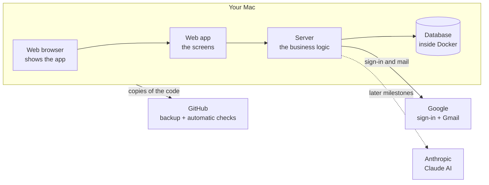

# The technical decisions, explained for non-technical readers

**Audience: Creators and business analysts.** This explains every technical choice made when EmailManager was built,
and that the [Creator Playbook](./CREATOR_PLAYBOOK.md) makes for every new app: what each thing is, an everyday
comparison, why it was chosen, where it runs, and what it costs.

## The big picture: what runs where

The most important point: **the app doesn't run "in the cloud".** There is no rented server, no virtual machine and
no cloud database. Everything runs on your own Mac. A few outside services are used only for things that can't live
on your Mac (your Google sign-in and mailbox, a backup of the code, and later the AI).

| Where                                       | What lives there                                                                                                                | Cost                              |
| ------------------------------------------- | ------------------------------------------------------------------------------------------------------------------------------- | --------------------------------- |
| **Your Mac**                                | The app's screens, its server and its database; your settings file with the secret keys                                         | Free                              |
| **Google** (Google Cloud)                   | The sign-in screen and your Gmail mailbox. The app only borrows access with your permission                                     | Free                              |
| **GitHub**                                  | A backup copy of the code with its full history, and automatic checks on every change                                           | Free                              |
| **Anthropic** (later milestones)            | The Claude AI that will judge emails and draft replies                                                                          | Pay per use; small for one person |
| **Claude** (the assistant building the app) | Claude runs in Anthropic's cloud and works on your Mac through the Claude app, with your permission, only in the project folder | Your Claude plan                  |

## 1. Building blocks of the app

| Decision                                | What it is                                                                                                | Everyday comparison                                     | Why this choice                                                                                 |
| --------------------------------------- | --------------------------------------------------------------------------------------------------------- | ------------------------------------------------------- | ----------------------------------------------------------------------------------------------- |
| **A website on your Mac** ("localhost") | The app opens in your web browser at `http://localhost:5180`. "localhost" means "this computer"           | A shop that only opens its doors inside your own house  | Private, free, nothing to host or secure on the internet. Can be moved to a server later        |
| **TypeScript**                          | The programming language for all parts                                                                    | One common language spoken by everyone on the team      | Catches many mistakes before the app runs; the same language for screens and server             |
| **Node.js** (version 22)                | The engine that runs TypeScript programs on your Mac                                                      | The motor that makes the app go                         | Standard, free, widely supported. The exact version is pinned so it behaves the same every time |
| **React**                               | Builds the screens (Inbox, Sign in…)                                                                      | Lego blocks for screens                                 | The most widely used way to build web screens; easy to find help and developers                 |
| **Vite**                                | Serves the screens to your browser while you work, and updates them instantly                             | A projector showing the latest slide                    | Very fast to start and refresh                                                                  |
| **React Router**                        | Moves between screens (Inbox → To Respond) and keeps the address bar in step                              | Signposts between rooms                                 | Standard companion to React                                                                     |
| **TanStack Query** + **axios**          | Fetch data from the server, remember it briefly and show "Loading…"                                       | A messenger with a short-term memory                    | Fewer bugs around loading and refreshing data                                                   |
| **Fastify**                             | The server: the part that applies rules, talks to Google and the database                                 | The back office of a shop                               | Fast, simple and well supported                                                                 |
| **ts-rest** + **Zod**                   | A written contract between screens and server about what can be asked and answered, checked automatically | A purchase order form both sides must fill in correctly | Screens and server can't silently disagree; bad requests are rejected politely                  |

## 2. Storing data

| Decision                            | What it is                                                                                                                      | Everyday comparison                                                       | Why this choice                                                                                                                  |
| ----------------------------------- | ------------------------------------------------------------------------------------------------------------------------------- | ------------------------------------------------------------------------- | -------------------------------------------------------------------------------------------------------------------------------- |
| **PostgreSQL** ("Postgres")         | The database that stores users, sign-in sessions, encrypted Google tokens and settings (later: categories and the activity log) | A well-organized filing cabinet                                           | Reliable, free, industry standard                                                                                                |
| **Docker Desktop**                  | A program on your Mac that runs Postgres in a sealed box called a "container"                                                   | A shipping container: everything inside is packed the same way every time | Installs Postgres cleanly, without cluttering your Mac, and can be removed completely. **It runs on your Mac, not in the cloud** |
| **Two databases**: "dev" and "test" | One for your real use, one that automated tests can freely fill and empty                                                       | A real ledger and a practice ledger                                       | Tests can never damage your real data                                                                                            |
| **Drizzle**                         | Translates between the program and the database, and records each change to the database's layout ("migrations")                | An interpreter plus a logbook of renovations                              | Database changes are tracked and repeatable                                                                                      |
| **No email bodies stored**          | The app keeps only what it needs (who you are, settings, results); email text is read from Gmail when needed                    | Reading a letter at the post office instead of photocopying it            | Privacy                                                                                                                          |

## 3. Signing in and security

| Decision                                   | What it is                                                                                                                                               | Everyday comparison                                       | Why this choice                                                                                        |
| ------------------------------------------ | -------------------------------------------------------------------------------------------------------------------------------------------------------- | --------------------------------------------------------- | ------------------------------------------------------------------------------------------------------ |
| **Sign in with Google (OAuth)**            | Google's standard "Sign in with Google" screen. The app never sees your Google password; Google gives it a limited permission slip                       | A valet key that opens the doors but not the glovebox     | Secure and familiar; no passwords to manage                                                            |
| **Google Cloud project in "Testing" mode** | Registers the app with Google so it may ask for permission. Testing mode limits sign-in to people you list (your QA account)                             | A guest list at the door                                  | No Google review needed; free. Side effect: Google asks you to sign in again every 7 days              |
| **Gmail permission "modify"**              | The smallest permission that allows reading, labeling, starring, archiving, drafting and sending. Not "delete forever", not your contacts                | A key to the mail room but not the shredder               | Enough for the app's job, no more. Sending is further limited in the app's code to replies you approve |
| **Session cookie**                         | After sign-in, the browser keeps a random ticket that proves it's you, unreadable by web pages                                                           | A wristband at an event                                   | Standard and safe; expires after 30 days                                                               |
| **Encrypted tokens** (AES-256-GCM)         | Google's permission slip is stored scrambled with a secret key only your Mac has                                                                         | A safe-deposit box                                        | Even if the database were copied, the permission couldn't be used                                      |
| **The `.env` settings file**               | A private file on your Mac holding the Google keys and the encryption key. Never uploaded                                                                | The combination to the safe, kept in your desk            | Secrets never go to GitHub or into chat                                                                |
| **Separate QA account**                    | All manual testing uses a spare Gmail account; your personal mailbox is never used                                                                       | A test kitchen                                            | Mistakes during development can't touch real mail                                                      |
| **Private GitHub email address**           | Code changes are signed with a GitHub "noreply" address instead of your real email                                                                       | A P.O. box                                                | Your real address doesn't appear in public history                                                     |
| **Test-only sign-in**                      | Automated tests sign in without Google, but this door exists only in test mode, and the app refuses to start if test mode is mixed with real Google keys | A rehearsal stage door that's bricked up on opening night | Tests never reach a real mailbox                                                                       |

## 4. Quality and safety nets

| Decision                       | What it is                                                                                                               | Everyday comparison                    | Why this choice                                  |
| ------------------------------ | ------------------------------------------------------------------------------------------------------------------------ | -------------------------------------- | ------------------------------------------------ |
| **Automated tests (Vitest)**   | Small programs that check each piece and each business rule; 66 of them after milestone 1                                | A checklist run after every change     | Problems are caught immediately, not by you      |
| **Browser tests (Playwright)** | A robot opens a real browser, signs in (test mode) and clicks through the app using a fake mailbox                       | A mystery shopper                      | Proves the whole app works end to end            |
| **Fake mailbox**               | A pretend Gmail with 60 made-up emails, used by all automated tests                                                      | A flight simulator                     | Realistic testing without real email             |
| **Prettier + ESLint**          | Automatic formatting and a "spell checker" for code                                                                      | Spell-check and house style            | Consistent, readable code; fewer mistakes        |
| **GitHub Actions**             | On every change saved to GitHub, GitHub reruns the checks and tests on its own computers                                 | An independent inspector               | A second opinion that doesn't depend on your Mac |
| **Supply-chain protection**    | New versions of outside building blocks are only accepted once they're 2 days old, and they may not run install programs | Not buying a product on its launch day | Protects against tampered downloads              |

## 5. Organizing the work

| Decision                                                                         | What it is                                                                                                                       | Everyday comparison                          | Why this choice                                                                 |
| -------------------------------------------------------------------------------- | -------------------------------------------------------------------------------------------------------------------------------- | -------------------------------------------- | ------------------------------------------------------------------------------- |
| **Git**                                                                          | Records every change with who, when and why, and allows going back                                                               | "Track changes" for the whole project        | Nothing is lost; every step can be reviewed                                     |
| **GitHub** (`howardpodeswa/EmailManager`, public)                                | The online home of the Git history                                                                                               | An off-site backup                           | Safety and sharing. Public by choice, which is why emails and keys are kept out |
| **One repository, many packages** ("monorepo", using **pnpm** and **Turborepo**) | Screens, server and shared pieces live in one project, organized in labeled boxes, and only the parts that changed are rechecked | One building with labeled departments        | Easy to keep everything consistent                                              |
| **nvm**                                                                          | Keeps the right version of Node.js for this project                                                                              | Keeping the right adapter for each appliance | Different projects can use different versions safely                            |
| **Milestones with checkpoints**                                                  | Build in small stages; you approve each before the next                                                                          | Stage payments on a renovation               | You stay in control and see progress early                                      |
| **Start / Stop files**                                                           | Double-clickable files that start Docker, the database, the server and the screens, then open the browser                        | A single light switch for the whole house    | No technical typing to use the app                                              |
| **Provider "plug"**                                                              | Everything Gmail-specific sits behind one connector                                                                              | A universal power adapter                    | Outlook (or others) can be added later without rebuilding the rest              |

## 6. What was deliberately _not_ used

| Not used                                         | Why not                                                                             |
| ------------------------------------------------ | ----------------------------------------------------------------------------------- |
| Cloud hosting, virtual machines, cloud databases | Not needed for one user on one Mac; avoids cost, setup and exposure on the internet |
| A sign-in service (e.g. SuperTokens)             | Google sign-in handled directly is simpler and needs no extra service               |
| Mobile app                                       | The requirements call for a desktop browser                                         |
| Google billing or free trials                    | Not required for sign-in or the Gmail API at this scale                             |

## 7. Coming in later milestones

| Decision                            | What it is                                                                                                                             | Why                                                                                       |
| ----------------------------------- | -------------------------------------------------------------------------------------------------------------------------------------- | ----------------------------------------------------------------------------------------- |
| **Claude API** (Anthropic)          | Judges spam, automated mail, "reply needed" and urgency, and drafts replies. Called only from the server, sending only the text needed | Accurate judgments in plain language; privacy limits apply (no attachments, trimmed text) |
| **pg-boss**                         | A to-do queue kept in the database, for long jobs like "Categorize 200 emails"                                                         | Lets the screen show progress and a Cancel button                                         |
| **Google Safe Browsing** (optional) | Google's list of dangerous websites, used to check links                                                                               | Extra phishing protection when a key is provided; skipped otherwise                       |
